# Ominvox

[](https://github.com/KrishnaVaibhav/Ominvox/actions/workflows/ci.yml)
[](https://github.com/KrishnaVaibhav/Ominvox/actions/workflows/codeql.yml)
[](LICENSE)


**Watch any film in your own language, in the actors' own voices.**

Ominvox listens to whatever is playing on your Windows PC (a movie, a YouTube video, a call), translates what people say, and speaks it back. Each speaker keeps a voice that sounds like them, in the new language. It can also translate whole **audio and video files** into one or many languages.

Everything runs **on your own computer**: no cloud, no account, no subscription. Your audio never leaves your PC.

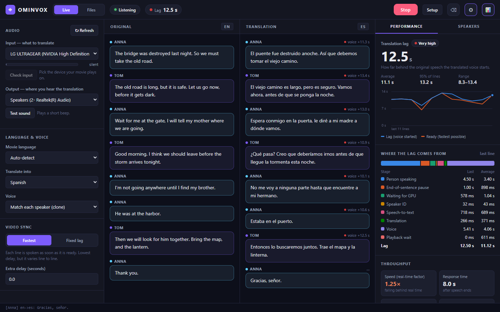

---

## What it can do

| | Feature | In short |
|---|---|---|
| 🎧 | **Live translation** | Translates the sound of any app (a film, YouTube, a video call) or a microphone, as it plays. |
| 🗣️ | **Keeps each speaker's voice** | Tells the speakers apart and gives each one a matching voice in the new language. |
| 🎬 | **Translate files** | Turns an MP3 or a video into one, several or all 17 voice languages. Add the new languages to the video as extra audio tracks, replace the sound, or save separate audio files, plus subtitles. |
| ⏱️ | **Video sync** | Keeps the delay constant so you can shift the video by the same amount and see lips and voice line up. |
| 📊 | **Performance panel** | Shows how far the voice trails the speech, where the time goes, and how hard your GPU is working. |
| 🔒 | **Private and offline** | After the one-time download, it runs without internet. Nothing is uploaded. |

**Languages it speaks:** English, Spanish, French, German, Italian, Portuguese, Polish, Turkish, Russian, Dutch, Czech, Arabic, Chinese, Hungarian, Korean, Japanese and Hindi. It **understands** about 100 languages (anything Whisper recognises), and can show text translations into more languages than it can speak.

## Quick start

1. **Download** `OminvoxSetup.exe` from the [Releases page](https://github.com/KrishnaVaibhav/Ominvox/releases) and run it ([details](#2-install)).
2. **Open Ominvox** and follow the four setup steps; it downloads the AI models once ([details](#3-first-start-the-setup-screen)).
3. **Live:** pick your speakers as *Input* and your headphones as *Output*, choose a language, press **Start Listening** and play a video ([details](#4-live-translation)).
   **Files:** click **Files**, drop in a video or MP3, tick the languages, press **Translate** ([details](#translate-an-audio-or-video-file)).

> ⚠️ Use **different devices** for the movie and the translation (for example speakers + headphones), or Ominvox will hear its own voice and translate it again. See [section 5](#5-avoid-the-echo-problem-important).

---

## Contents

1. [What you need](#1-what-you-need)
2. [Install](#2-install)
3. [First start: the setup screen](#3-first-start-the-setup-screen)
4. [Live translation](#4-live-translation)
   - [Translate an audio or video file](#translate-an-audio-or-video-file)
   - [Files, command line](#files-in-the-ominvox-folder)
5. [Avoid the echo problem (important)](#5-avoid-the-echo-problem-important)
   - [Sync the translation with your video](#sync-the-translation-with-your-video)
6. [Settings (config.yaml)](#6-settings-configyaml)
7. [Troubleshooting and FAQ](#7-troubleshooting-and-faq)
8. [Updating and uninstalling](#8-updating-and-uninstalling)
9. [For developers](#9-for-developers)

---

## 1. What you need

| Requirement | Details |
|---|---|
| **Windows 10 or 11** | Audio capture uses a Windows-only feature (WASAPI loopback). Mac and Linux are not supported. |
| **NVIDIA graphics card** | At least **8 GB of video memory** (for example an RTX 3070, 4060 Ti, 4070 or better). 6 GB works with smaller settings ([section 6](#6-settings-configyaml)). AMD and Intel graphics cards won't work. |
| **Up-to-date NVIDIA driver** | The setup screen checks this and links to the download if needed. |
| **About 20 GB free disk space** | For Python, the AI libraries and the models. The installer picks the drive with the most free space. |
| **16 GB RAM** or more | 32 GB is recommended. |
| **Internet connection** | Only while installing and downloading the models. After that it works offline. |
| **Headphones** | Strongly recommended. See [section 5](#5-avoid-the-echo-problem-important). |

You do **not** need to install Python or anything else yourself.

---

## 2. Install

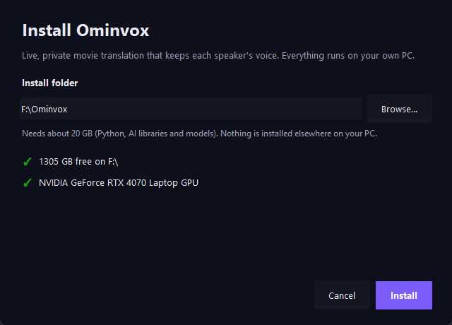

1. Download **`OminvoxSetup.exe`** from the [Releases page](https://github.com/KrishnaVaibhav/Ominvox/releases) (or build it yourself; see [section 9](#9-for-developers)).
2. Double-click it. If Windows SmartScreen says "Windows protected your PC", click **More info → Run anyway**. The app isn't code-signed.
3. Check the install folder (the drive with the most free space is pre-selected). The installer shows the free space and the graphics card it found. Click **Install**.
4. Wait 10–30 minutes while it downloads Python and the AI libraries. A progress bar shows each step, and you can keep using your PC.
5. Click **Open Ominvox**. Shortcuts are also added to your **Desktop** and **Start menu**.

Nothing is installed outside that folder, apart from the two shortcuts.

<br clear="right">

<details>
<summary><b>Manual install (without the installer)</b></summary>

1. On <https://github.com/KrishnaVaibhav/Ominvox>, click **Code → Download ZIP**, then extract it to a folder **without spaces** (for example `D:\Ominvox`).
2. In that folder, click the address bar, type `powershell` and press **Enter**.
3. Run:

   ```powershell
   powershell -ExecutionPolicy Bypass -File .\setup.ps1
   ```

   This downloads the same things as the installer, then builds `Ominvox.exe` and adds a desktop shortcut.
4. If your network blocks the download of the `uv` tool, get `uv-x86_64-pc-windows-msvc.zip` from <https://github.com/astral-sh/uv/releases/latest> and put `uv.exe` in a folder named `.tools` inside the Ominvox folder.

Already use Anaconda? `scripts\setup_conda.bat` builds the same environment with conda.
</details>

---

## 3. First start: the setup screen

The first time Ominvox opens, it walks you through four short steps (about 10 minutes, mostly downloading). A green tick means a step is done. You can reopen it any time with the **Setup** button at the top.

| | |
|---|---|
| 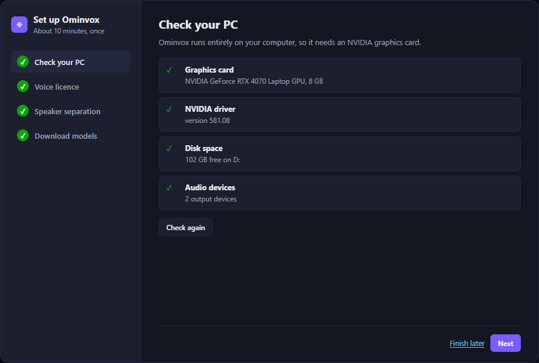 | 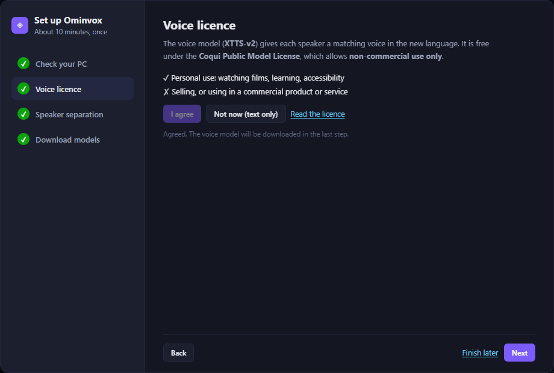 |
| 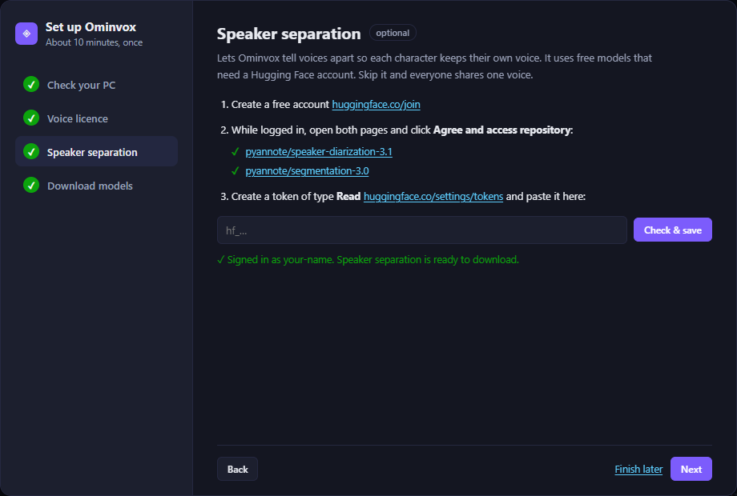 | 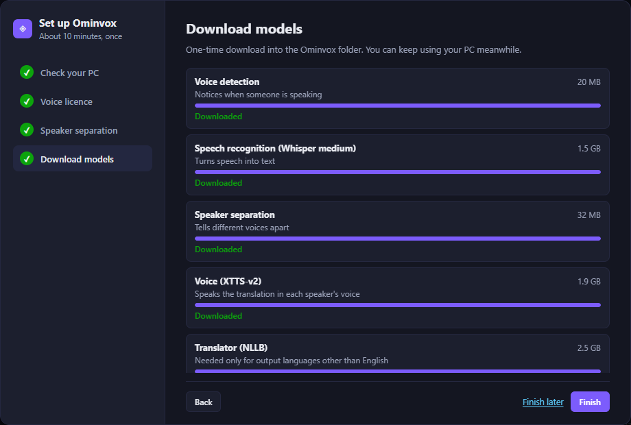 |

1. **Check your PC.** Confirms the NVIDIA graphics card and driver, disk space and audio devices. If something's wrong, it says what to do, with a **Get driver** button where relevant.
2. **Voice licence.** The voice model (XTTS-v2) is free for **non-commercial use only** (Coqui Public Model License). Click **I agree** to turn voices on. If you choose **Not now**, translations are shown as text only.
3. **Speaker separation (optional).** Lets Ominvox tell voices apart so every character keeps their own voice. It needs a free Hugging Face account:
   1. Create an account at **huggingface.co/join**.
   2. While logged in, open the two model pages shown and click **Agree and access repository** on each.
   3. Create a token of type **Read** at **huggingface.co/settings/tokens**, paste it into the box and click **Check & save**.

   The screen confirms your account and both model pages with green ticks. The token is stored only on your PC (in the `.env` file). Skip this step and everyone shares one voice; you can add it later.
4. **Download models.** Shows each model with its size and a progress bar, plus speed and time left. The total is about 3.5 GB. Tick *Also get the translator* if you want output in languages other than English (+2.5 GB). Downloads resume if they're interrupted.

Click **Finish**. You're ready.

---

## 4. Live translation

Open Ominvox from the desktop or Start menu shortcut. It opens in its own window, in **Live** mode. If you prefer a browser tab, double-click `start_ui.bat` instead (it opens <http://127.0.0.1:8765>).

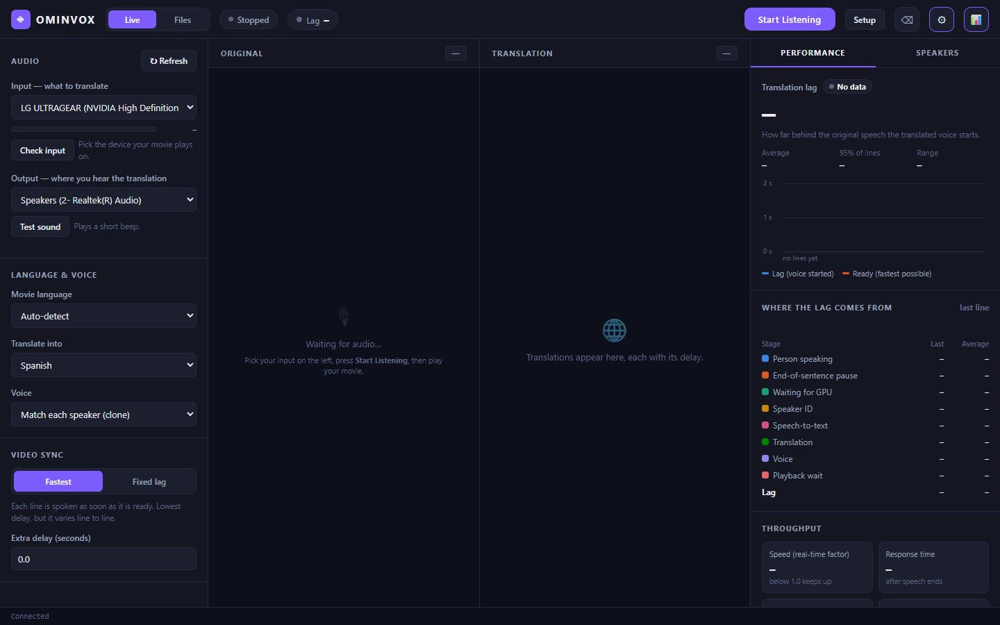

**In four steps:**

1. **Input**: choose the speakers or headphones **your movie plays on** (or a microphone).
2. **Output**: choose where you want to **hear the translation** (a different device; see [section 5](#5-avoid-the-echo-problem-important)).
3. **Translate into**: choose your language.
4. Press **Start Listening** and play the movie. The first start loads the models (15–30 seconds); after that, Stop and Start are instant.

The window has three columns. The ⚙ and 📊 buttons at the top hide or show the side columns.

### Left: audio, language and sync

| Control | What it does |
|---|---|
| **Input** | Where the sound to translate comes from. Under *Computer sound* pick the speakers or headphones **your movie plays on**; under *Microphones* pick a mic to translate a live speaker. *Automatic* uses your default speakers. |
| **Check input** | Listens to the chosen input for 10 seconds **without loading the AI models**. Play something: the level bar turns green if sound is arriving. |
| **Output** | Where you hear the translation. |
| **Test sound** | Plays a short beep on the chosen output. |
| **↻ Refresh** | Re-scans devices after you plug something in. |
| Yellow warning | Appears when input and output are the same device. See [section 5](#5-avoid-the-echo-problem-important). |
| **Movie language / Translate into / Voice** | Change any time, even while listening. *Auto-detect* works for most films; choose the language if it guesses wrong on short lines. |
| **Video sync** | *Fastest* or *Fixed lag*. See [Sync the translation with your video](#sync-the-translation-with-your-video). |

Every choice is saved and restored the next time you open Ominvox. Devices are remembered by name, so plugging hardware in or out doesn't mix them up.

### Middle: the transcript

- The left column shows **who spoke** and what they said; the right column shows the **translation**, in the speaker's colour.
- Every translation is tagged with its delay, for example `voice +5.6 s`. Hover over the tag to see where the time went.
- **⌫** at the top clears the transcript.

### Right: Performance and Speakers

<table><tr>
<td width="50%">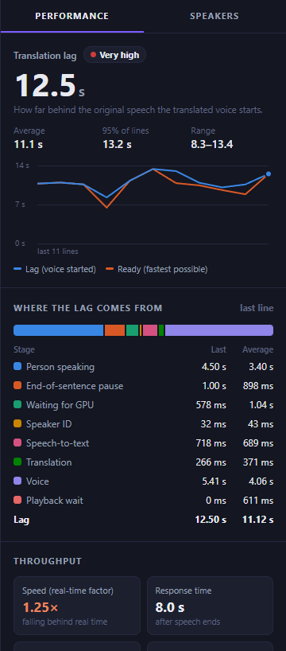</td>
<td width="50%">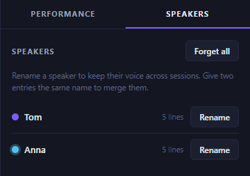</td>
</tr></table>

**Performance** (left picture) shows the live numbers:

> The pictures were taken on a laptop whose graphics card stayed in a power-saving state, so the voice step was slow and the lag shown (about 11 s) is higher than a GPU running at full speed gives. On laptops, use the maximum-performance power and GPU mode.

| Item | Meaning |
|---|---|
| **Translation lag** | How long after the original line **starts** the translated voice starts. Green under 3 s, yellow under 5 s, orange under 8 s, red above. The header shows the same number. |
| **Average / 95% of lines / Range** | Over the last 30 lines. |
| **Lag chart** | Blue = when each line was actually spoken. Orange = when it was ready, the fastest possible. Dashed = your fixed lag, in Fixed mode. |
| **Where the lag comes from** | The last line's lag, split into its parts. These always add up to the lag: the person speaking (whole sentences are translated), the end-of-sentence pause (about 1 s of silence), waiting for the GPU, speaker ID, speech-to-text, translation, voice, and playback wait. |
| **Speed (real-time factor)** | Processing time ÷ length of speech. **Below 1.0 the app keeps up**; above 1.0 it falls behind. |
| **Response time** | From the end of a sentence to its translation being ready. |
| **Playback backlog / queue** | Translated audio still waiting to play, and lines waiting for the GPU. Growing numbers mean it can't keep up. |
| **Lines** | Translated, spoken, late (Fixed mode), dropped and errors. |
| **System** | GPU load, GPU memory, GPU temperature, CPU and memory, and the devices in use. |

**Speakers** (right picture) lists the detected voices:
- **Rename** a speaker (for example "Unknown 2" to "Captain"). Names are remembered, so the same voice gets the same name next time.
- If one person shows up twice, rename the second entry to the **same name** as the first to merge them.
- **Forget all** (click twice to confirm) clears every saved speaker. Use it when you switch to a different movie.

To stop, click **Stop**. To quit, close the window.

**Voice modes:**
- **Match each speaker (clone):** each speaker gets a voice that imitates them. Cloning starts after about 6 seconds of their speech; until then their lines use a built-in voice, chosen per speaker so people still sound different.
- **Preset voice:** one voice cloned from a `.wav` file you choose (`tts: preset_voice` in `config.yaml`).
- **One voice for everyone:** one built-in voice.

> **Languages:** you can switch the target language at any time, even while listening.
> - **English** uses Whisper's built-in translation (fastest).
> - **Any other language** uses the NLLB translator (download it in **Setup**). It loads within a few seconds of switching.
> - The voice speaks the 17 languages listed [at the top](#what-it-can-do). Other languages (such as Swedish) show the translated **text only**.

### Translate an audio or video file

Click **Files** at the top of the window (next to **Live**). Here Ominvox translates a whole file instead of what is playing, and saves the result. It's slower than real time but more accurate than Live mode, because it can look at the whole file.

| | |
|---|---|
| 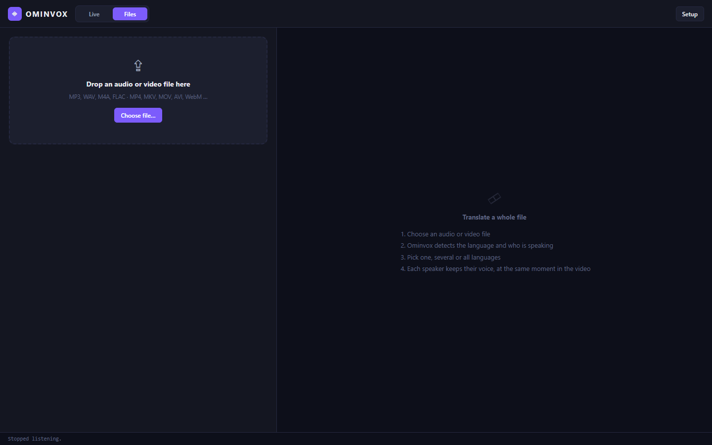 | 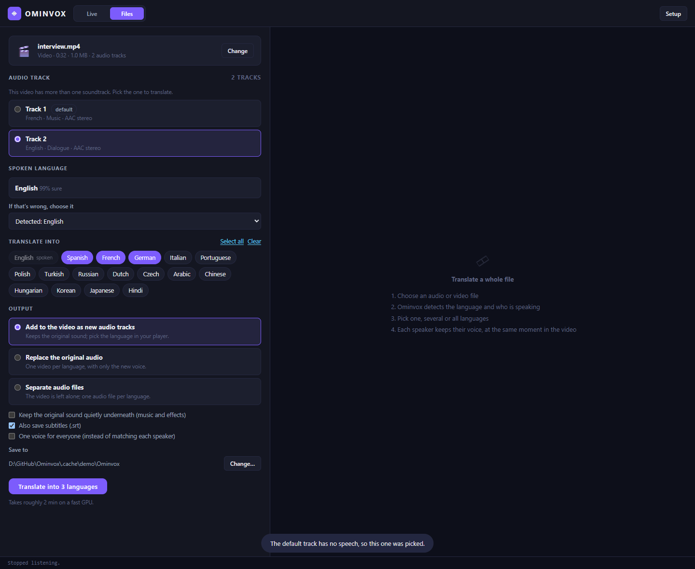 |
| 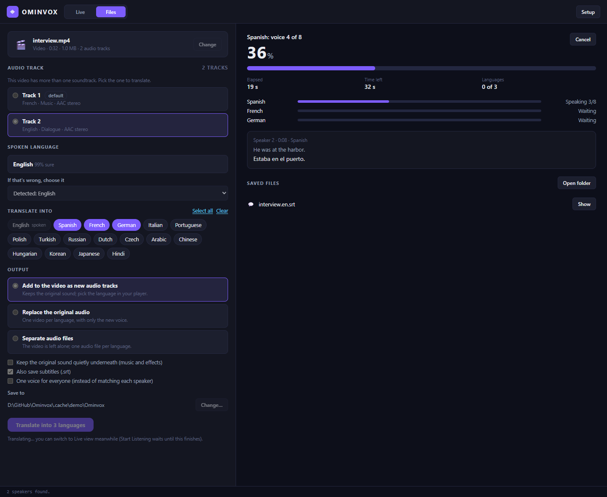 | 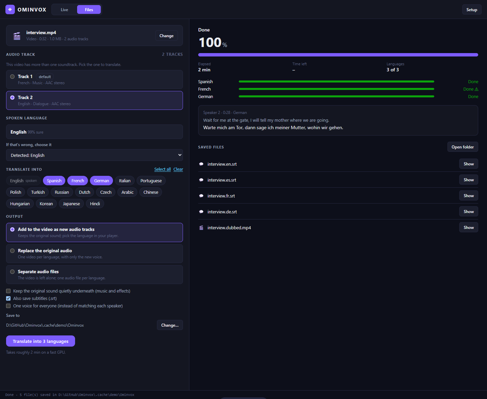 |

1. **Choose a file**: click **Choose file…** or drag the file onto the window. Audio (MP3, WAV, M4A, FLAC, …) and video (MP4, MKV, MOV, AVI, WebM, …) both work.
2. **Audio track** (videos with more than one): pick the soundtrack to translate. Ominvox shows each track's language and name. If the first track has no speech (music or effects only), it switches to one that does.
3. **Spoken language** is detected automatically and shown with how sure it is. If it's wrong, choose the right one.
4. **Translate into**: click one or more languages, or **Select all** (16 languages: every voice language except the spoken one).
5. **Output**:

   | Choice | What you get |
   |---|---|
   | **Add to the video as new audio tracks** | One video with the original sound **plus** one track per language. Choose the language in your player (VLC: Audio → Audio Track). |
   | **Replace the original audio** | One video per language, with only the new voice (`film.es.mp4`, `film.de.mp4`, …). |
   | **Separate audio files** | One audio file per language (MP3, M4A or WAV). The video isn't touched. Audio files always give this. |

   Options:
   - **Keep the original sound quietly underneath**: the music and effects stay in. The original voices also stay, softly, because they can't be separated from the music.
   - **Also save subtitles**: `.srt` files for the original and each language.
   - **One voice for everyone**: use one voice for all speakers instead of matching each speaker.
6. Click **Translate**. Progress shows each language, the time left and the line being spoken. **Cancel** stops it at any time. When it's done, **Show** opens each file in Explorer.

Results go to an **`Ominvox`** folder next to the file. Use **Change…** to save them somewhere else. Existing files are never overwritten (a second run makes `film.es (2).mp3`). The video picture is copied as it is, never re-encoded, so it keeps its full quality and saving is quick.

| You chose | You get (for `film.mp4`, Spanish + German, subtitles on) |
|---|---|
| Add to the video | `film.dubbed.mp4` (original + Spanish + German tracks), `film.en.srt`, `film.es.srt`, `film.de.srt` |
| Replace the audio | `film.es.mp4`, `film.de.mp4` and the subtitles |
| Separate audio files | `film.es.mp3`, `film.de.mp3` and the subtitles |

How long it takes (measured on an RTX 4070 laptop): about **0.6–1.5 minutes per language for every minute of audio**, plus about 10 seconds per minute to recognise the speech once. It is slower when other programs are using the graphics card. So a 2-hour film takes roughly 1–3 hours per language, and "Select all" is an overnight job. The time-left estimate in the app adjusts as it goes.

Good to know:

- Each line starts **where the original line started**. When a translation is longer than the original, that line is spoken a little faster (up to 1.35×). If it still doesn't fit, the next line starts slightly late. A ⚠ next to a finished language means this happened, and hovering shows by how much.
- Languages other than English need the translator (**Setup → Download models**, 2.5 GB). English uses Whisper and needs nothing extra.
- Live listening and file translation share the AI models, so only one can run at a time. **Start Listening** waits until the file is done (or cancelled). You can switch back to the Live view while a file is translating.

### Files in the Ominvox folder

| File | What it does |
|---|---|
| `Ominvox.exe` | Opens the app in its own window (the normal way to use Ominvox). |
| `start_ui.bat` | Opens the same interface in your web browser instead. |
| `scripts\audiotest.bat` | Play something, then run this: it listens for 15 seconds and shows whether sound is being captured. |
| `scripts\devices.bat` | Lists all your audio devices with their numbers (for `config.yaml`). |
| `scripts\check.bat` | Self-test: are the libraries installed and is the GPU usable? |
| `config.yaml` | All settings (see [section 6](#6-settings-configyaml)). |
| `user_settings.json` | The choices you made in the app (created automatically). |
| `.env` | Your Hugging Face token (created by the setup screen). Keep it private. |
| `.cache\` | The downloaded AI models and your saved speakers. |
| `logs\` | `ominvox.log` (app) and `setup.log` (installer). Useful when something goes wrong. |

### Command line (optional)

```bat
run.bat --window             REM app window (what Ominvox.exe runs)
run.bat --ui                 REM web interface in the browser (same as start_ui.bat)
run.bat --check              REM self-test
run.bat --list-devices       REM show audio devices
run.bat --audio-test         REM check that sound is being captured
run.bat --target es          REM run without the UI, translating to Spanish
run.bat --ui --port 9000     REM use a different port for the web page

REM Translate a file (same as the Files tab):
run.bat --dub "D:\Movies\film.mkv" --to es,fr --output-mode add
run.bat --dub talk.mp3 --to all --audio-format m4a --keep-background
REM   --track 1 (second audio track)   --source ja (skip detection)
REM   --output-mode separate|add|replace   --no-subtitles   --out D:\Dubbed
```

---

## 5. Avoid the echo problem (important)

Ominvox records **whatever your output device plays**. If the translated voice plays on the **same** speakers it is recording, it hears itself and translates its own voice again, in a loop.

```
 Fix 1 (two devices)                      Fix 2 (virtual cable)

 movie ──► Speakers ──► Ominvox           movie ──► CABLE Input ──► Ominvox
                          │                                          │
 you   ◄── Headphones ◄───┘               you   ◄── Headphones ◄─────┘
           (translation)                            (translation only)
```

Pick one of these fixes:

**Fix 1: two different devices (simplest).** Play the movie through one device and send the translation to another. For example, the movie plays on your monitor or laptop speakers, and **Output** is your headphones.

**Fix 2: a virtual audio cable (best for one pair of headphones).**
1. Download and install **VB-CABLE** (free) from <https://vb-audio.com/Cable/>, then restart your PC.
2. In your movie player, or in Windows **Settings > System > Sound > Volume mixer**, set the movie app's output to **CABLE Input**.
3. In Ominvox, set **Input** to **CABLE Input** (under *Computer sound*) and **Output** to your headphones.

You'll then hear only the translation in your headphones, with no echo.

### Sync the translation with your video

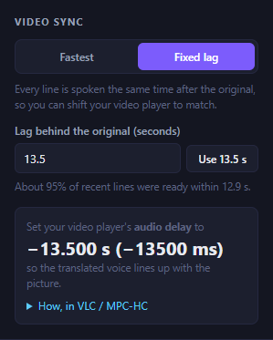

Translation can't start until a sentence is finished, so the translated voice always comes a few seconds after the original. You can't remove that delay, but you can **make it constant and shift the video to match**:

1. Start listening and play the movie for about a minute. In the **Video sync** box, choose **Fixed lag**.
2. Click **Use X.X s**. This is a lag that about 95% of lines can make, based on live measurements. Every line is now spoken exactly that long after the original. Lines that miss it are marked *late* and counted in **Lines**.
3. The box shows the value to enter in your video player, for example **−7.000 s (−7000 ms)**. Set your player's **audio delay** to that value:
   - **VLC:** Tools → Track Synchronization → *Audio track synchronization*. You can also press **J** / **K** to move it in 50 ms steps.
   - **MPC-HC / MPC-BE:** Options → Internal Filters → Audio Switcher → enable *Time shift* and enter the milliseconds.

The player now sends the movie's sound early, Ominvox translates it, and the translated voice arrives in step with the picture. This works best with Fix 2 above (a virtual cable), so you hear only the translation.

**Keeping the lag low:**
- Lag is mostly **sentence length** plus about 1 s of pause detection. "Where the lag comes from" shows this.
- A smaller `stt: model` (for example `small`) speeds up speech-to-text.
- English output is fastest, because it skips the separate translator.
- Lower `vad: silence_chunks` in `config.yaml` (default 4 × 0.25 s) to detect sentence ends sooner, at the cost of splitting sentences more often.

<br clear="right">

> **Translating a file you own?** The [Files tab](#translate-an-audio-or-video-file) has no lag at all: every line starts where the original did.

---

## 6. Settings (config.yaml)

Most things can be changed in the app. For anything else, open **`config.yaml`** in Notepad, edit it, save, and restart Ominvox. Lines starting with `#` are comments.

| Setting | What it does | Typical values |
|---|---|---|
| `translate: target_lang` | Language to translate into | `en`, `es`, `fr`, `de`, `hi`, `ja`, ... |
| `translate: source_lang` | Language of the movie | `auto` (detect), or a code like `ja` |
| `stt: model` | Speech-recognition size. Bigger is more accurate but slower and uses more video memory. | `small`, `medium` (default), `large-v3` |
| `stt: device` | Use the graphics card or the processor | `cuda` (GPU, default), `cpu` (very slow) |
| `diarize: enabled` | Tell different speakers apart | `true` / `false` |
| `mt: backend` | Translation engine. `auto` uses Whisper for English and NLLB for everything else. `whisper` gives English only; `nllb` always uses NLLB. | `auto` (default), `whisper`, `nllb` |
| `tts: voice_mode` | Voice style | `match`, `preset`, `single` |
| `tts: preset_voice` | Path to a `.wav` voice sample (10–30 s of clear speech) for preset mode | `D:\voices\me.wav` |
| `tts: fallback_voice` | Built-in voice for single mode | `Claribel Dervla`, `Damien Black`, `Ana Florence`, `Andrew Chipper` |
| `files: max_speedup` | How much faster a translated line may be spoken so it ends before the next one starts | `1.35` (default), `1.0` (never) – `1.6` |
| `files: background_volume` | Volume of the original sound under the new voice, when that option is on | `0.3` (default), `0`–`1` |
| `speaker_id: threshold` | How similar two lines must sound to count as the same person. Raise it if different people get merged; lower it if one person gets split. | `0.62` (default), `0.55`–`0.75` |
| `speaker_id: min_seconds` | Lines with less speech than this (like "No.") are given to the closest known speaker instead of creating a new one | `1.6` |
| `vad: silence_chunks` | How much silence (× 0.25 s) ends a sentence in Live mode | `4` (default), `3`–`6` |
| `playback: sync_mode` | `asap` speaks each line as soon as it's ready; `fixed` keeps a constant lag for syncing with the video | `asap` (default), `fixed` |
| `playback: fixed_lag_ms` | The constant lag in `fixed` mode | `4000`–`10000` |
| `playback: delay_ms` | Extra wait in `asap` mode | `0` (default) |
| `audio: input_device_index` | Fixed capture device number (from `scripts\devices.bat`). `null` means automatic. | `null`, `26` |
| `playback: output_device_index` | Fixed playback device number. `null` means default. | `null`, `19` |

Choices made in the app (devices, languages, sync, licence, setup, Files options) are saved to **`user_settings.json`** and override `config.yaml`. Delete that file to go back to the `config.yaml` values, including showing the setup screen again.

The Hugging Face token lives in **`.env`** (`HF_TOKEN=hf_...`). The setup screen writes it for you; you can also edit it by hand, using `.env.example` as a template.

**Low on video memory (6 GB card)?** Set `stt: model: "small"`, or set `diarize: enabled: false`.

---

## 7. Troubleshooting and FAQ

### Troubleshooting

| Problem | Fix |
|---|---|
| Installer stops with an error | Click **Try again**. The full output is in `logs\setup.log` inside the install folder. Most failures are a dropped internet connection. |
| "Could not get uv.exe" | Your network blocked a download. See *Manual install*, step 4, in [section 2](#2-install). |
| Setup screen: graphics card ✕ | Install the latest NVIDIA driver (**Get driver**), restart, then click **Check again**. On a laptop, plug it in and make sure the NVIDIA GPU isn't disabled. |
| Token: "pages marked ✕ haven't been accepted" | Open each ✕ page while logged in, click **Agree and access repository**, then **Check & save** again. |
| A model download fails | Check your internet connection and click **Download** again; it resumes where it stopped. |
| **Start** opens the setup screen | Something it needs isn't downloaded yet. Finish the **Download models** step. |
| Level bar stays grey or `audiotest` says SILENCE | Pick a different **Input**: the one matching the device your movie actually plays on. Make sure the movie isn't muted. |
| `Invalid number of channels` | Choose a different input device, or set `input_device_index` in `config.yaml` using a number from `scripts\devices.bat`. |
| Translation repeats itself in a loop | That's the echo problem; see [section 5](#5-avoid-the-echo-problem-important). |
| Output is English even though another language was chosen | Make sure `mt: backend` in `config.yaml` is `auto` (not `whisper`), and that the translator is downloaded (**Setup → Download models**). |
| Message "Speaker separation is OFF" | Add the Hugging Face token in **Setup** (step 3). Everything else works meanwhile; everyone just shares one voice. |
| Message "Voice is OFF" | Agree to the voice licence in **Setup** (step 2). |
| One person appears as several "Unknown" speakers | Rename the extra entries to the same name to merge them, or lower `speaker_id: threshold` slightly. |
| "Audio input failed" / "Audio output failed" | The chosen device is unplugged or in use. Pick another one, or choose Automatic. Click **↻ Refresh** after plugging devices in. |
| The lag is high | Open **Where the lag comes from**. If *Person speaking* is the biggest part, that's sentence length and can't be avoided (use Fixed lag to sync instead). If *Speech-to-text* or *Voice* is large, or Speed is above 1.0, use a smaller `stt: model` or close other GPU programs. |
| Many lines marked *late* in Fixed lag mode | Click **Use X.X s** again, or raise the lag by 0.5–1 s. |
| Files: "No speech was found in this file" or the wrong language detected | Pick another **Audio track** (some videos keep the dialogue on a second track), or choose the spoken language yourself. |
| Files: I only hear the original language | The new languages are extra tracks: choose one in your player's audio-track menu (VLC: Audio → Audio Track). If your player has no such menu, use VLC or MPC-HC, or choose **Replace the original audio** instead. |
| Nothing happens when opening `Ominvox.exe` | Look at `logs\ominvox.log` in the Ominvox folder. `Ominvox.exe` must stay in that folder. |
| Out of memory / CUDA OOM | Use a smaller `stt: model` (`small`), or close games and other GPU-heavy apps. |

Still stuck? [Open an issue](https://github.com/KrishnaVaibhav/Ominvox/issues/new/choose) and attach `logs\ominvox.log`.

### FAQ

<details>
<summary><b>Is anything sent to the internet?</b></summary>

No. The models are downloaded once from Hugging Face and Coqui; after that Ominvox works offline. The audio, the transcripts, your speakers and your files stay on your PC. The app's page only listens on your own computer (`127.0.0.1`) and refuses connections from other websites.
</details>

<details>
<summary><b>Can I use it commercially?</b></summary>

The Ominvox code is Apache-2.0, but the voice model (XTTS-v2) and the translator (NLLB) are licensed for **non-commercial use only**. So using Ominvox with them is limited to personal, non-commercial use. See [Licences](#licences).
</details>

<details>
<summary><b>Why is there a delay of a few seconds?</b></summary>

A sentence can only be translated once it's finished (the end of a sentence can change the meaning of its start). Then it's recognised, translated and spoken. Use [Fixed lag](#sync-the-translation-with-your-video) to line the voice up with the video, or use the Files tab, which has no delay.
</details>

<details>
<summary><b>Does it work with AMD or Intel graphics, or on a Mac?</b></summary>

Not yet. The AI models need an NVIDIA graphics card (CUDA), and live capture uses a Windows feature.
</details>

<details>
<summary><b>How good is the voice match?</b></summary>

It imitates the pitch and character of each voice from a few seconds of speech, so speakers are easy to tell apart and sound like themselves. It won't fool anyone into thinking the actor really speaks the language. Clear dialogue gives the best results; loud music or many people talking at once make it harder.
</details>

<details>
<summary><b>Can I translate a YouTube video or a stream?</b></summary>

Yes, in Live mode: play it in your browser and pick the device it plays on as **Input**. For a video file you have on disk, the Files tab gives better quality.
</details>

---

## 8. Updating and uninstalling

**Update:** run a newer `OminvoxSetup.exe` and choose the same folder. It replaces the program files and keeps your settings, token, speakers, models and Python environment.

**Uninstall:** delete the Ominvox folder, plus the **Ominvox** shortcuts on your Desktop and in the Start menu. Nothing else was installed.

---

## 9. For developers

Ominvox is plain Python 3.12 (FastAPI, PyTorch, PyAV) with a front end of plain HTML, CSS and JavaScript (no build step). Contributions are welcome; start with [CONTRIBUTING.md](CONTRIBUTING.md).

### Run it from source

```powershell
git clone https://github.com/KrishnaVaibhav/Ominvox.git
cd Ominvox
powershell -ExecutionPolicy Bypass -File setup.ps1 -NoShortcut   # portable Python + libraries into .venv312\
run.bat --ui                                                      # opens http://127.0.0.1:8765
```

`setup.ps1` puts everything inside the project folder: `.tools\uv.exe`, the Python environment in `.venv312\`, and every cache (Hugging Face, torch, Coqui) in `.cache\`. The app's setup screen downloads the models. Edit the files in `ominvox\ui\web\` and reload the page to see front-end changes; restart `run.bat` for Python changes.

### How it works

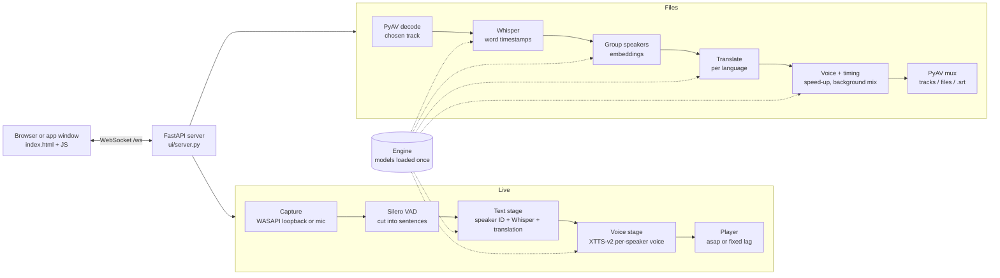

- **One `Engine`** (`pipeline/engine.py`) loads each model on first use and shares it between Live and Files, so the GPU holds one copy. Only one of them runs at a time.
- **Live** (`pipeline/orchestrator.py`): capture yields timestamped chunks; the VAD cuts them into sentences; a single GPU worker runs the text stage (speaker embedding → speaker ID, Whisper, translation) and then the voice stage; the player schedules each clip and reports when it really played, which drives the latency metrics.
- **Files** (`files/dubber.py`): transcribe the whole track with word timestamps, find speakers, then for each language translate, speak, fit each line into its original time slot, and write the result with `files/media.py`.
- **UI**: `ui/server.py` serves the page and a WebSocket. The page sends commands (`start`, `set_config`, `file_start`, …) and receives events (`utterance`, `stats`, `file_progress`, …). `ui/window.py` shows the same page in a native window (pywebview / Edge WebView2).

### The WebSocket protocol

All messages are JSON objects with a `type`. The page only talks to the server this way (plus `PUT /api/upload` for dropped files).

| Page → server | Does |
|---|---|
| `start`, `stop` | Start or stop live listening (loads the models the first time). |
| `set_config` | Change any live setting (devices, languages, voice mode, sync, delays). |
| `rename_speaker`, `reset_speakers` | Rename or merge a speaker; forget all speakers. |
| `refresh_devices`, `test_output`, `check_input`, `stop_check_input` | Device list, test beep, 10-second input check. |
| `fr_*` | Setup screen: state, licence, token, downloads (`ui/onboarding.py`). |
| `file_*` | Files tab: pick, open, detect, start, cancel, reveal (`ui/files_tab.py`). |

| Server → page | Carries |
|---|---|
| `status` | Live state (`stopped`, `loading`, `running`), the config and the known speakers. |
| `utterance` | One transcribed and translated line, with speaker and timing. |
| `line_metrics`, `stats` | Per-line lag breakdown; rolling performance and GPU/CPU numbers. |
| `level`, `probe`, `devices`, `speakers` | Input level meter, input check result, device lists, speaker roster. |
| `onboarding`, `need_setup` | Setup screen state; a request to open it. |
| `file_state`, `file_track`, `file_lang`, `file_started`, `file_progress`, `file_done`, `file_error`, `file_cancelled`, `file_out_dir` | Files tab state and job progress. |
| `log` | A line for the log strip at the bottom of the page. |

### Layout

```
ominvox\
  app.py                 CLI entry point (--window, --ui, --check, --list-devices, --dub, ...)
  config.py              config.yaml + user_settings.json + .env; pins every cache to .cache\
  audio\
    devices.py           WASAPI device lists, PortAudio init/teardown lock
    capture.py           loopback / mic capture (timestamped chunks)
    player.py            playback, asap / fixed-lag scheduling, resampling
  pipeline\
    engine.py            the models, loaded once (lazily) and shared by live + files; warm-up
    orchestrator.py      live: segmenting, GPU worker (text stage + voice stage), stats
    vad.py  diarize.py  speaker_id.py  stt.py  mt.py  voices.py
    metrics.py           per-line lag breakdown, rolling stats, GPU/CPU stats
  files\
    media.py             PyAV: probe tracks, decode, write audio, add/replace tracks (no re-encode)
    dubber.py            whole-file translation: transcribe, speakers, translate, voice, timing
    languages.py         the 17 voice languages, names, ISO-639-2 track tags
  firstrun\
    checks.py            GPU / driver / disk / audio checks
    hf_token.py          verify + save the Hugging Face token
    models.py            model registry, presence checks, downloads with progress
  ui\
    server.py            FastAPI + WebSocket server (pipeline lifecycle, devices, settings)
    onboarding.py        first-run screen backend (fr_* messages)
    files_tab.py         Files tab backend (file_* messages), one job at a time
    dialogs.py           native open-file / choose-folder dialogs
    window.py            native window (pywebview / Edge WebView2)
    web\                 index.html, app.css, app.js, setup.js, files.js (no build step)
installer\
  launcher.py            Ominvox.exe (stdlib only)
  installer.py           OminvoxSetup.exe (tkinter; embeds the app as payload.zip)
  build_payload.py       packs the app files for the installer
  make_icon.py           draws assets\ominvox.ico
scripts\                 build_exe.bat (local build), build_release.ps1 (CI / release build), audiotest/devices/check.bat, setup_conda.bat
tests\                   test suites + run_all.py
.github\                 CI, CodeQL and release workflows, issue / PR templates, Dependabot
docs\                    maintainer notes, project plan, history; screenshots.py + images\ (README pictures)
setup.ps1                environment setup (used by the installer and manual installs)
run.bat / start_ui.bat   launchers with caches pinned
```

### Where to start for common changes

| You want to… | Look at |
|---|---|
| Change something on screen | `ominvox/ui/web/index.html` (markup), `app.css`, then `app.js` (Live), `files.js` (Files) or `setup.js` (setup screen). Server side: `ui/server.py`, `ui/files_tab.py`, `ui/onboarding.py`. Retake the README pictures with `docs\screenshots.py`. |
| Add a setting | Add it to `config.yaml` with a comment, read it where it's used, and if the app should change it, handle it in `UIServer._apply_config` and `_config_payload`. Document it in [section 6](#6-settings-configyaml). |
| Add a voice language | XTTS-v2 decides which languages can be spoken. Add it to `VOICE_LANGS` in `files/languages.py` and to the target list in `index.html`; NLLB codes are mapped in `pipeline/mt.py`. |
| Swap or tune a model | `pipeline/engine.py` loads them; each stage has its own module (`stt.py`, `mt.py`, `voices.py`, …). Register downloads in `firstrun/models.py`. Check VRAM and latency in the performance panel before and after. |
| Change how files are timed or mixed | `files/dubber.py` (`_voice_track`, `_speak`, `_mix_background`); containers and codecs in `files/media.py`. |
| Change the installer | `installer/installer.py` and `setup.ps1`; build with `scripts\build_exe.bat`. |

### Building the programs

```bat
scripts\build_exe.bat            REM Ominvox.exe + dist\OminvoxSetup.exe
scripts\build_exe.bat launcher   REM only Ominvox.exe
```

`OminvoxSetup.exe` embeds every **committed** file except `tests\`, `docs\`, `installer\` and the contributor files, plus the freshly built `Ominvox.exe`, so commit before building a release. Official releases are built by GitHub Actions when a version tag is pushed (see [docs/MAINTAINING.md](docs/MAINTAINING.md)). For scripted installs: `OminvoxSetup.exe --silent --dir D:\Ominvox [--no-shortcuts]` (progress in `logs\install.log`).

### Tests

```bat
.venv312\Scripts\python.exe tests\run_all.py          REM fast + GPU suites (no sound), ~15 min
.venv312\Scripts\python.exe tests\run_all.py fast     REM no GPU models (~1 min); CI runs these
.venv312\Scripts\python.exe tests\run_all.py all      REM also the suites that PLAY SOUND
```

| Suite | Needs | Covers |
|---|---|---|
| `test_metrics`, `test_firstrun`, `test_speaker_id`, `test_files_unit` | nothing | latency maths, setup checks and downloads, speaker matching, file helpers and media I/O |
| `test_pipeline`, `test_comprehensive`, `test_real_voices` | GPU + models | each AI stage, the whole live pipeline, voice cloning with real voices |
| `test_e2e`, `test_files` | GPU + models | the server and WebSocket flow, file translation end to end (tracks, languages, outputs, cancel) |
| `test_audio_devices`, `test_live_ui` | GPU + speakers | real capture and playback (these **play sound**) |

The sound suites use your default speakers unless you name other devices, for example to keep test sounds out of the headphones you're wearing:

```bat
set OMINVOX_TEST_DEVICE=LG ULTRAGEAR
set OMINVOX_TEST_OUTPUT=Realtek
```

Every pull request runs **Lint** (ruff, a JavaScript syntax check, a scan for committed tokens), the **fast tests** on Windows and an **installer build**; all three must pass before merging. GitHub's machines have no GPU, so run the GPU suites locally when you change the pipeline, the file translation or the server.

### Notes

- **Python 3.12 is required** (coqui-tts doesn't support 3.13).
- `setup.ps1` installs the libraries, then **reinstalls PyTorch 2.6 + CUDA 12.4 last**, so nothing can replace it with a CPU build. pyannote.audio 4 *declares* `torch>=2.8`, but runs correctly on 2.6, and 2.6/cu124 works with older drivers. Every test passes on this combination.
- `transformers` is pinned `<5` (coqui-tts 0.27 imports a symbol removed in 5.x). NLLB loads with `use_safetensors=False`, which avoids a second 2.4 GB auto-converted copy.
- **Models are downloaded by the first-run screen** (`firstrun/models.py`), not by setup. Progress is measured from bytes on disk in each model's cache folder, so it works the same for Hugging Face, Coqui and torch.hub. Hugging Face calls get `cache_dir` explicitly, because huggingface_hub fixes its default cache path at import time.
- **Voice licence:** XTTS loads only after the user agrees (`tts.license_accepted`, which then sets `COQUI_TOS_AGREED`). Without it the app runs text-only.
- **Speaker identity comes from the voice embedding**, not pyannote's label (each utterance is diarized alone, so the label is almost always `SPEAKER_00`). The full diarization pass only runs as a fallback when no embedding is available. Clips with less than `speaker_id.min_seconds` of voiced audio are matched but never enrolled.
- **One GPU worker, models loaded one after another, on purpose.** On an 8 GB card, a second worker (text and voice in parallel) and parallel model loading each cost about 0.6 GB more VRAM (per-thread CUDA workspaces). That pushed the card into shared memory, and voice synthesis went from about 1.0 s to 3.6 s per line. See the note in `orchestrator.py`.
- **Capture** uses blocking-mode streams but only reads frames that are already available. Callback mode fails (-9999) when this process also plays to the device, and a plain blocking `read()` would hang on a silent loopback. `chunks()` yields `None` when nothing arrives, and the segmenter treats that as silence.
- **Latency:** capture chunks carry monotonic timestamps; `lag = play_t - seg_start`, and the eight parts in `metrics.STAGES` sum to it exactly. In `fixed` mode the player schedules each clip at `seg_start + fixed_lag`.
- Device lists are **WASAPI only**: one entry per device, full names. WASAPI shared mode needs the device's native rate and channels, so the player resamples the 24 kHz TTS audio.
- Models are warmed up once after loading, so the first line isn't slower than the rest. A second launch reuses a running instance (`/api/health`), so the models are never loaded twice.
- **File translation** uses PyAV (FFmpeg's libraries, bundled in the `av` wheel that faster-whisper already needs), so there's nothing extra to install. Video and subtitle packets are copied as they are; only the new audio is encoded (AAC, or Opus for WebM; other containers become MKV). Each language's audio is encoded to a temporary file as soon as it's ready, so memory stays flat even for a 2-hour film with many languages.
- In files, **Whisper uses word timestamps**: lines start and end where the words do, and a segment is split where a sentence ends before a pause (usually a speaker change). After speakers are found, back-to-back lines from the same speaker are joined again, because XTTS sounds better on whole sentences and goes wrong on very short ones. Speakers are grouped with the same embeddings as live mode: long lines seed the groups and short lines only join one.
- **NLLB translates sentence by sentence.** Given several sentences at once, the 600M model often drops one. On short input it also adds subtitle-style dashes and repeats ("- Gracias. - Gracias."), which `mt.clean_output` removes. Files use beam search (4 beams). **To English, files use Whisper's own translation**, which is better and needs no download.
- XTTS sometimes babbles on after short text, so an implausibly long result is re-spoken once and, if it's still too long, cut with a fade.
- **Security:** the WebSocket and the upload endpoint refuse other websites' pages (Origin check), because any page in the browser can reach `127.0.0.1`. "Show in folder" only opens files the Files tab itself produced.
- **README screenshots** (`docs/images/`) come from the real app: `docs\screenshots.py` runs the server, feeds the test dialogue in silently instead of a device, and drives the page in headless Edge. Rerun it after changing the UI (`python docs\screenshots.py live,files` for some scenes only). The numbers in the pictures are real measurements on the PC that took them.
- See `docs\PROJECT_PLAN.md` for the original roadmap.

### Contributing

Contributions are welcome! Read [CONTRIBUTING.md](CONTRIBUTING.md) for setup, code style and how tests and pull requests work, and the [Code of Conduct](CODE_OF_CONDUCT.md). Report security problems privately ([SECURITY.md](SECURITY.md)). Maintainer notes: [docs/MAINTAINING.md](docs/MAINTAINING.md).

### Licences

The Ominvox code is licensed under the **[Apache License 2.0](LICENSE)**. Copyright 2026 Krishna Vaibhav; see [NOTICE](NOTICE).

The AI models aren't part of this repository. Ominvox downloads them on first run, and each keeps its own licence:

- **XTTS-v2** (voice): Coqui Public Model License, **non-commercial use only**. The app asks you to agree before downloading or using it.
- **NLLB-200** (translation to languages other than English): CC-BY-NC 4.0, **non-commercial use only**.
- **pyannote** speaker models: MIT and CC-BY 4.0, gated on Hugging Face (you accept their terms there).
- **Whisper** (faster-whisper) and **Silero VAD**: MIT.

So while the code is free for any use, **using Ominvox with these models is limited to non-commercial use**.
